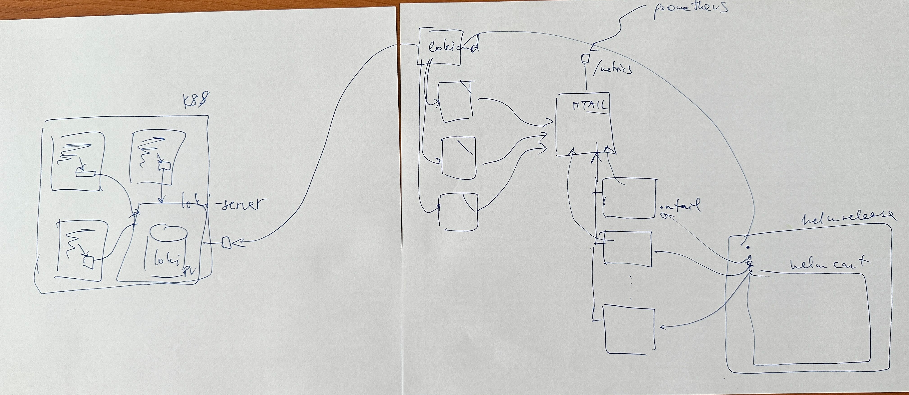

# Promlogs

* [promlogs custom helm chart](https://github.com/beskar-cloud/custom-helm-charts/tree/main/promlogs)
* [promlogs helm release](https://github.com/beskar-cloud/beskar-flux/blob/master/apps/g2-oidc/04-lma/04-lma.base/16-promlogs.yaml)

## Overview

Promlogs is a Helm chart designed for log monitoring and metrics extraction from Loki logs. It uses mtail to parse logs, extract metrics based on defined patterns, and expose them as Prometheus metrics. This solution is particularly useful for monitoring errors and warnings across various applications in your Kubernetes cluster.

The main change from the previous version is that only one connection is made to loki and the logs extracterd from the loki are save to single log file `/app/logs/os_all.log` and the separation of the components are made on the [mtail programs](https://github.com/beskar-cloud/custom-helm-charts/tree/main/promlogs/templates/programs.yaml).

## Architecture
Promlogs deploys the following components:

1. A deployment running a container that:

  * Retrieves logs from Loki using logcli
  * Runs mtail to parse logs and extract metrics
  * Exposes metrics on port 3903 for Prometheus scraping
  * Periodically cleans up logs based on retention policy

2. ConfigMaps:

  * entrypoint: Contains the entrypoint script that sets up and runs the components
  * programs: Contains mtail programs generated from the configuration

# Configuration
Under `logParsing.combinedQuery` is possible to define query for logcli [now is configured like this](https://github.com/beskar-cloud/beskar-flux/blob/master/apps/g2-oidc/04-lma/04-lma.base/16-promlogs.yaml) to prevent saving all the logs and take only the one we want to watch.

## Log Parsing configuration
Under `logParsing.generic_regexps` are defined regexes for `errors` and `warning`.

## Application to monitor
Under `logParsing.programs` you can define mtail prgrams, where by query are application and components selected from logcli.
Also is possible to look for exactl patterns and log it separately eg. [pattern example](https://github.com/beskar-cloud/beskar-flux/blob/master/apps/g2-oidc/04-lma/04-lma.base/16-promlogs.yaml)

